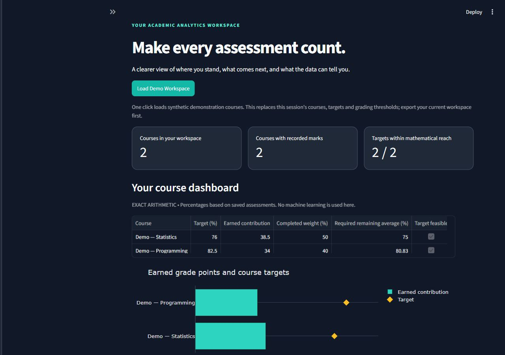
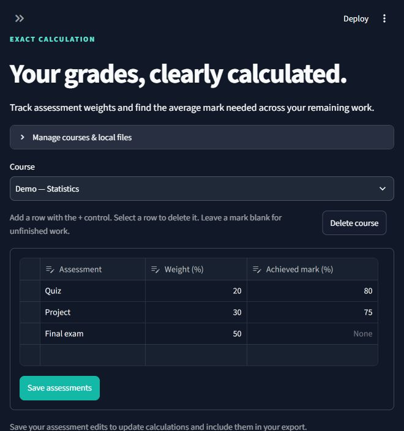
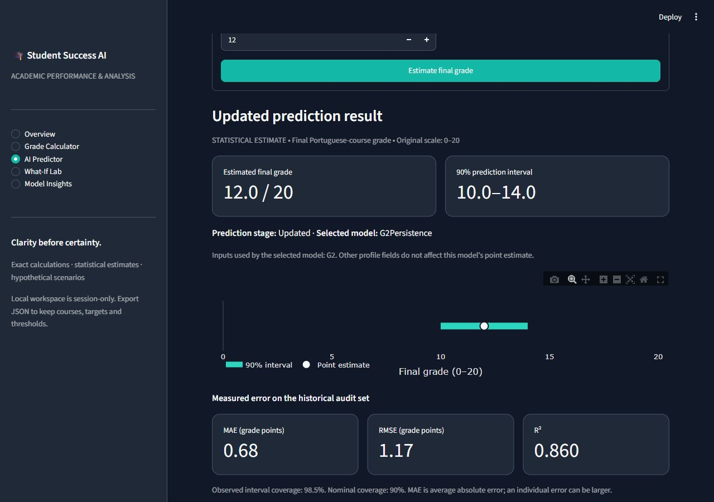

# Student Success AI

**Academic Performance Prediction & Analysis Platform**

A Streamlit application that separates exact course-grade calculations, statistical grade estimates, and hypothetical scenarios. Built as a reproducible data-science portfolio project with transparent baselines and uncertainty.

**[Open the hosted demo](https://student-success-ai-zaki.streamlit.app/)** · Streamlit Community Cloud · **Access currently restricted** (public access not yet confirmed)

[GitHub Actions](https://github.com/zaki-coding/student-grade-predictor-/actions/workflows/quality.yml) · [MIT license](LICENSE) · [Model methodology](reports/methodology.md) · [Deployment checklist](docs/deployment.md) · [Privacy](docs/privacy.md)



**Try the demo:** choose **Load Demo Workspace** on Overview. This one-click action replaces only the current session's workspace with the existing synthetic example, including marks, targets, and grading boundaries. Export your own workspace first if you want to keep it.

## Hosted application

**Deployed:** [student-success-ai-zaki.streamlit.app](https://student-success-ai-zaki.streamlit.app/) using `main`, `app/Home.py` and Python 3.13.18. The Streamlit app was last confirmed as **available only to specific people**; visitors may be asked to sign in or request access. The GitHub repository remains private. Deploying the app does **not** automatically make the app or its source public.

The hosted demo dashboard, calculator, early and updated predictions, What-If Lab, JSON/CSV downloads and Markdown prediction-report download were tested successfully. The optional Plotly chart-to-PNG download could not be confirmed in browser automation; that is **unverified**, not a proven application defect. See [deployment and public-release checklist](docs/deployment.md).

## Features

- **Overview:** saved course summaries, earned contributions, and target feasibility.
- **Grade Calculator:** multiple courses, assessment weights, unfinished marks, configurable thresholds, and exact remaining-mark planning. It does not require prediction initialization.
- **AI Predictor:** early and updated estimates on the original **0–20** scale, active inputs, historical error, prediction intervals, and input-support warnings.
- **What-If Lab:** comparisons using the selected model's actual inputs, with explicit noncausal interpretation.
- **Model Insights:** data distributions, missingness, correlations, model comparisons, residuals, baselines, and interval diagnostics.
- **Portable workspaces and reports:** version 1/2 JSON restore, exact grade-summary CSV, and prediction Markdown reports disclosing uncertainty and limitations.

## Install and run locally

Python **3.13** is the recommended tested version; the CI matrix also covers Python **3.11**. From a fresh checkout in Windows PowerShell:

```powershell
py -3.13 -m venv .venv
.\.venv\Scripts\python -m pip install -r requirements.txt
.\.venv\Scripts\python -m src.local
```

The local launcher binds to **127.0.0.1**, and serves the app at [localhost:8501](http://127.0.0.1:8501/). Use `--port 8502` if needed. On Linux/macOS, create the environment with `python3 -m venv .venv` and replace `.\.venv\Scripts\python` with `.venv/bin/python`.

**No training command, generated model file, external model download, or developer session is needed to enable predictions.** Installation needs access to the package registry; model initialization uses bundled public data and reviewed recipes. Dependencies are declared in `pyproject.toml`; `requirements.txt` installs the project and its tests. Scikit-learn remains pinned to **1.8.0**. If Windows reports missing package files in a deeply nested folder, use a shorter checkout or virtual-environment path to avoid path-length limits.

## Trusted model initialization

The application never loads `.joblib` or pickle model artifacts. On the first prediction request in a server process, it verifies the bundled UCI source bytes, approved evaluation snapshots, model/version metadata, and recipe checksums. It then fits only the two already-selected methods on the original **389 training rows**, calibrates on the same **130 calibration rows**, and checks numerical parity with the approved historical outputs. It does not rerun model selection or change the statistical methodology.

A locked process cache holds only public training/model resources. It initializes both stages once and reuses them across interactions, with isolated copies preventing caller mutation from changing another session's resources. User inputs, predictions, uploads, and course records are not put into that shared cache. Initialization errors show a safe explanation; the calculator remains available.

The trust boundary is the reviewed repository. Hashes detect corruption or mismatched resources; they are not a signature against an attacker who can replace the code and manifest together. Arbitrary `model_dir` paths are rejected without deserialization; the argument remains only for compatibility with the registered default model location. See [the deployment notes](docs/deployment.md) and bundled resource attribution.

## Measured results and limits

Source: [UCI Student Performance](https://archive.ics.uci.edu/dataset/320/student+performance), Cortez (2008), DOI [10.24432/C5TG7T](https://doi.org/10.24432/C5TG7T), licensed [CC BY 4.0](https://creativecommons.org/licenses/by/4.0/). We use only the **649 Portuguese-language course records** from two Portuguese secondary schools, avoiding cross-subject student overlap. The target is **G3** on the original **0–20** scale, not university GPA or percentages. See [the dataset card](docs/data-card.md).

These are unchanged Iteration 2 measurements; errors are grade points.

| Stage / method | Audit MAE | Audit RMSE | Audit R² |
| --- | ---: | ---: | ---: |
| Early selected: Linear Regression | 2.135 | 2.806 | 0.193 |
| Early mean baseline | 2.404 | 3.186 | −0.041 |
| Early median baseline | 2.369 | 3.143 | −0.013 |
| Updated selected: G2 persistence | 0.677 | 1.170 | 0.860 |
| Updated G1/G2-only linear baseline | 0.736 | 1.161 | 0.862 |

| Selected stage | Nominal interval | Observed coverage | Covered / total | 95% Wilson bounds | Mean width |
| --- | ---: | ---: | ---: | ---: | ---: |
| Early | 90% | 89.2% | 116 / 130 | 82.7%–93.5% | 8.983 |
| Updated | 90% | 98.5% | 128 / 130 | 94.6%–99.6% | 3.985 |

The updated method **is the latest-grade baseline**: its point estimate equals G2. It won training-only validation; no extra ML value over that baseline is claimed. Early MAE did not materially improve over Phase 1, so the simpler linear model was retained. The broad early interval limits individual usefulness.

**The test set has already been inspected. These results are a reused historical audit, not fresh independent validation.** The split remains 389 training / 130 calibration / 130 audit rows with seed 42, preprocessing inside training folds, and a predeclared simplicity-aware selection rule. G3 and full-year absences never enter predictors. Early questionnaire timing remains retrospective.

Conformal intervals target marginal coverage under exchangeability, not personal or subgroup guarantees. The early age 18–22 group covered only **21/28 outcomes (75%)**. Input-support screens are heuristics and cannot establish applicability to a new institution. No prospective, external, fairness, or causal validation is claimed. Do not use this application for admissions, discipline, grading, or other high-stakes decisions.

[Full methodology](reports/methodology.md) · [Generated ML audit](reports/ml_audit.md) · [Metrics](reports/metrics.json) · [Historical snapshots](reports/phase1/)

## Research reproduction and tests

The full experiment is separate from app initialization:

```powershell
.\.venv\Scripts\python -m src.train
.\.venv\Scripts\python -m pytest -q
.\.venv\Scripts\python -m compileall -q src app
.\.venv\Scripts\python -m pip check
```

Training compares the original candidates and Ridge grid, regenerates numerical reports, and writes ignored research `.joblib` files. Those files are never loaded by the application. Generated experiment reports use canonical LF line endings. The recorded [seven-report reproducibility comparison](reports/reproducibility-iteration2.json) belongs to the documented experiment environment; small numerical/version differences on other systems are possible.

The release merge commit [`e4578a6`](https://github.com/zaki-coding/student-grade-predictor-/commit/e4578a6fdc51463e1d5ff73bb5d50a5bf24333b9) passed **all four** [Windows/Ubuntu, Python 3.11/3.13 CI jobs](https://github.com/zaki-coding/student-grade-predictor-/actions/runs/42296289289). The release preparation recorded **163 passing tests** in both working and clean-install environments; see [release validation](docs/release-validation.md). CI exercises the cold-checkout suite before the separate research-training step. The hosted app has also been tested with synthetic demo data, but these checks do not establish model validity for new student populations.

## Privacy and saved work

Use **synthetic demonstration data** for a public portfolio visit. When run locally, inputs are processed on the local machine. When hosted, course marks, uploaded JSON, and prediction inputs are transmitted to the app server and processed by the hosting provider; they do not stay solely on your device.

The application uses temporary session memory and upload/download buffers. It does not intentionally persist personal grades to server disk, log input contents, add accounts, or introduce analytics trackers. The server operator and hosting provider can still have infrastructure access and their own retention policies; the app does not promise immediate deletion or confidential download URLs. A session is not durable storage. Export your workspace before closing and keep downloaded JSON/CSV/Markdown files private.

Workspace uploads are limited to **1 MB**, validated before replacing the current session, and cannot supply model artifacts. Shared caches contain public model resources only. See [the complete privacy explanation](docs/privacy.md).

## Screenshots and release review

| Exact grade planning | Prediction stage and uncertainty |
| --- | --- |
|  |  |

[Model audit view](docs/screenshots/iteration2/insights.jpg) · [Mobile view](docs/screenshots/iteration2/mobile.jpg)

The application is hosted as an educational portfolio demonstration, not validated personal academic forecasting. The [deployment checklist](docs/deployment.md) describes the remaining public-access steps; the app and repository were last confirmed private. **Renaming the repository to `student-success-ai` remains optional** and has not been performed.

Code: [MIT](LICENSE). Data and derived reports: CC BY 4.0 with [third-party notices](docs/third-party-notices.md). Full study scheduling, new datasets, and monitoring remain future work.
