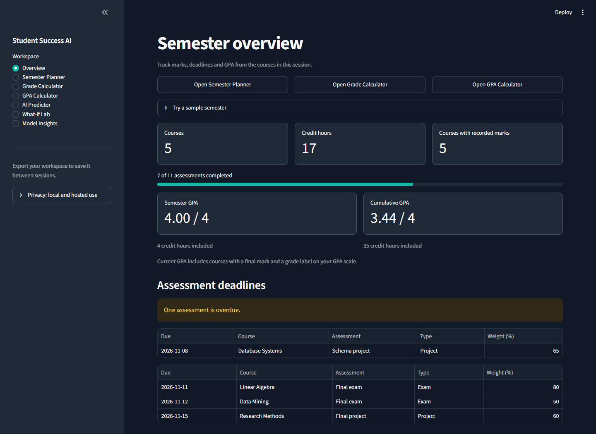

# Student Success AI

A Streamlit app for tracking grades, planning coursework, and exploring grade predictions. The planner and calculators use your course records. The prediction demo uses a separate public dataset.

The [live demo](https://student-success-ai-zaki.streamlit.app/) runs from the main branch.

## Features

- **Dashboard and semester planner** show course progress, deadlines, and targets using the same assessments as the grade calculator.
- **Grade calculator** calculates weighted grades, compares hypothetical marks, and shows the score you need on an unfinished exam or across remaining work.
- **GPA calculator** uses credit hours and your grading scale to calculate semester, cumulative, and hypothetical GPA.
- **Workspace files** let you restore older JSON workspaces, import courses and assessments from CSV, and download semester, grade, and GPA reports.
- **Prediction demo** shows early and updated estimates, prediction intervals, and a What-If Lab for comparing model inputs.

See [calculation examples](docs/academic-planning.md), [file formats](docs/workspace-files.md), and the [synthetic example workspace](docs/example-semester.json).

## Screenshots



[Mobile dashboard](docs/screenshots/v3/mobile.png) · [Prediction screen from the previous release](docs/screenshots/iteration2/predictor.jpg)

## Run locally

The app uses Python 3.11 or later, Streamlit and Plotly for the interface, pandas and NumPy for data handling, and scikit-learn for the prediction demo. The tests use pytest.

In Windows PowerShell:

```powershell
python -m venv .venv
.\.venv\Scripts\python -m pip install -r requirements.txt
.\.venv\Scripts\python -m src.local
```

On Linux or macOS, use `python3` to create the environment and `.venv/bin/python` in the last two commands. The launcher serves the app at [localhost:8501](http://127.0.0.1:8501/). To try it with sample records, open **Try a sample semester** on the dashboard and choose **Load Demo Workspace**.

The app fits its approved prediction recipes from bundled public data on first use. Installation requires the dependency packages. Running predictions requires no separate training command or model download.

## Prediction demo

The target is a Portuguese secondary-school course grade on a 0–20 scale. The **early** model uses linear regression with questionnaire and background fields. The **updated** method uses G2 persistence: the estimate is the second-period grade. The models and the academic calculators use different data and scales.

| Method | Historical audit MAE | Observed coverage of 90% nominal intervals |
| --- | ---: | ---: |
| Early linear regression | 2.135 / 20 | 116 of 130 (89.2%) |
| Updated G2 persistence | 0.677 / 20 | 128 of 130 (98.5%) |

These measurements come from the existing historical audit, which was inspected before version 3. Early intervals were about 9 points wide on average. Coverage for individual students, universities, and missing inputs has not been established. Input warnings flag profiles that differ from the training records.

The [version 3 development experiment](reports/development-evaluation-v3.md) used only the original training rows. Huber regression reduced early out-of-fold MAE from 2.084 to 2.057. Median regression on G1 and G2 tied G2 persistence at 0.797. Both are internal comparisons, so the app continues to use the approved methods. See the [model methodology](reports/methodology.md) and [historical audit](reports/ml_audit.md) for the split, baselines, and limitations.

## Project files

| Path | Contents |
| --- | --- |
| `app/` | Streamlit pages, workspace validation, and shared UI components |
| `src/` | Grade and GPA calculations, CSV tools, prediction, and research code |
| `resources/` | Bundled data and approved prediction snapshots |
| `tests/` | Calculation, import, model, and Streamlit workflow tests |
| `docs/` and `reports/` | Usage guides, evaluation results, and development history |

Run the suite with `python -m pytest`. Run the version 3 experiment with `python -m src.development_evaluation`. [GitHub Actions](https://github.com/zaki-coding/student-grade-predictor-/actions/workflows/quality.yml) runs the tests on Windows and Ubuntu. See the [architecture notes](docs/architecture.md) for how the modules fit together and the [deployment notes](docs/deployment.md) for the hosted entry point.

## Privacy and data

Course records, uploads, and prediction inputs are processed in session memory. On the hosted app, they are sent to the hosting server. Use synthetic data for public demos and export your workspace to keep it between sessions. See [privacy details](docs/privacy.md).

The prediction demo uses 649 Portuguese-language course records from two secondary schools. The dataset is Cortez (2008), *Student Performance*, UCI Machine Learning Repository, licensed CC BY 4.0. See the [dataset source](https://doi.org/10.24432/C5TG7T), [dataset card](docs/data-card.md), and [third-party notices](docs/third-party-notices.md). Project code uses the [MIT license](LICENSE).
