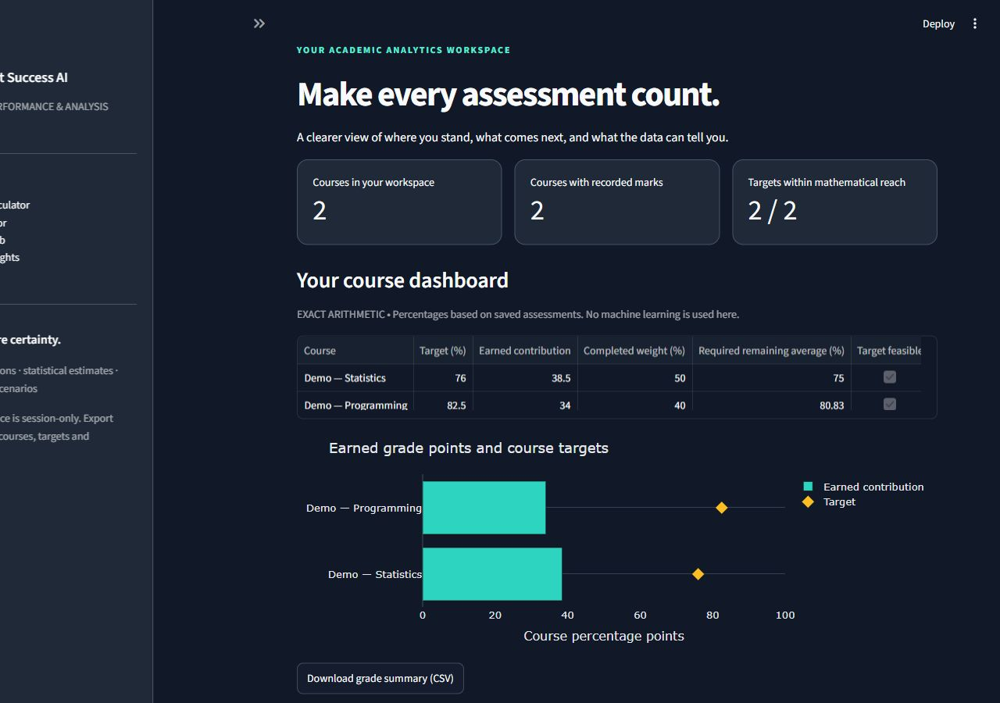

# Student Success AI

**Academic Performance Prediction & Analysis Platform**

A local Streamlit workspace for exact course-grade arithmetic, transparent statistical estimates, and hypothetical model comparisons. This project emphasizes reproducible experiments and honest uncertainty over model complexity.

## What you can do

- **Overview dashboard:** inspect saved course summaries, earned contributions, target feasibility, and meaningful empty states.
- **Grade Calculator:** manage courses and assessments, validate weights, track incomplete work, set per-course targets and grading thresholds, and explore exact remaining-mark scenarios. It works without a model.
- **AI Predictor:** see a grade estimate on the original **0–20** scale, its prediction stage, fitted method, historical errors, measured interval coverage, and input-support notices together.
- **What-If Lab:** compare supported model inputs and inspect the difference. These are model responses, not causal interventions.
- **Model Insights:** explore distributions, missingness, correlations, training-validation comparisons, residuals, stage-appropriate baselines, global importance, and interval diagnostics.
- **Portable local saves:** export and restore a versioned JSON workspace containing courses, targets, and grading boundaries. Original version 1 course exports still work.
- **Downloads:** export an exact grade-summary CSV or a prediction Markdown report containing submitted inputs, the model's own evaluation snapshot, uncertainty, and limitations.

The current implementation extends the original repository and preserves its history. The GitHub repository remains private; the application runs locally. See [development inspection](docs/development-inspection.md).

## Run locally

Use Python 3.11–3.13 and a writable checkout. From the repository root in Windows PowerShell:

```powershell
py -3.13 -m venv .venv
.\.venv\Scripts\python -m pip install -r requirements.txt
.\.venv\Scripts\python -m src.train
.\.venv\Scripts\python -m streamlit run app/Home.py
```

The app opens at [localhost:8501](http://localhost:8501). The default server binds to loopback (`127.0.0.1`) for local-only use. Training downloads the small public UCI dataset if absent, verifies its pinned checksum, compares candidate models, creates trusted local artifacts, and writes numerical reports. Installation and first acquisition need internet access; subsequent calculator and prediction use is local. An absent or outdated model produces a retraining message while the calculator stays available.

On Linux/macOS, use `python3 -m venv .venv` and `.venv/bin/python`. Dependencies are declared once in `pyproject.toml`; `requirements.txt` installs the project and test dependencies. Scikit-learn is pinned to **1.8.0**. Actual training versions and split indices are recorded in `reports/split_manifest.json`; retrain after dependency changes.

## Scientific scope

[Cortez's UCI Student Performance dataset](https://archive.ics.uci.edu/dataset/320/student+performance), DOI [10.24432/C5TG7T](https://doi.org/10.24432/C5TG7T), is licensed [CC BY 4.0](https://creativecommons.org/licenses/by/4.0/). Only the **649 Portuguese-language course records** are used, avoiding cross-subject student overlap. The target is final grade **G3**, a regression outcome on the original **0–20** scale. This is historical secondary-school data from two Portuguese schools, not university grades or percentages. The source has zero missing cells and zero identical full rows; reliable student IDs are unavailable, so independence cannot be proved.

The early configuration uses eight questionnaire/background predictors: age, parental education, travel time, study-time category, prior failures, internet access, and higher-education aspiration. Survey timing remains retrospective: this is a proxy for early information, not a prospectively validated early-warning system. Updated candidates can use G1/G2; the selected updated method currently uses **G2 only**. The API retains its compatible schema, while the UI distinguishes active predictors from inactive compatibility defaults. Neither G3 nor full-year absences is an input.

### Evaluation and audit

Seed **42** preserves the same **389 training / 130 calibration / 130 audit-test rows** across stages and iterations. Five-fold training-only cross-validation evaluates each complete preprocessing/model pipeline. Numeric imputation/scaling and categorical imputation/encoding are fitted within each fold. No calibration or test rows select candidates or fit feature transforms.

Iteration 2 adds meaningful baselines: training mean and median for early estimates; latest-grade **G2 persistence** and **G1/G2-only linear regression** for updated estimates. Experiments retain the existing linear/tree candidates and add a small fixed Ridge grid (`alpha=1,10,100`). The predeclared selection rule chooses the simplest candidate within one standard error of the lowest training-CV MAE. This is a conservative heuristic, not a hypothesis test. No larger model was justified.

**The 130-row test sample was already inspected in Phase 1. Current results are a reused historical audit, not fresh independent evidence of improvement.** The original numerical results are preserved in `reports/phase1/`. Training-only selection limits direct leakage but cannot undo benchmark reuse; new external/prospective data is required before claiming generalization gains.

Separate calibration residuals set a finite-sample split-conformal **90% nominal** prediction interval. Audit reports include actual coverage, counts, a 95% Wilson interval for that measured coverage, and descriptive groups. Nominal coverage is marginal under exchangeability; neither it nor a Wilson interval guarantees an individual's result. Discrete grades can produce conservative coverage. All point predictions and intervals consistently use the original bounded scale.

## Actual iteration 2 results

All errors are grade points on the **0–20** scale. These figures were produced locally with scikit-learn **1.8.0**; lower MAE/RMSE is better.

| Stage / method | Audit MAE | Audit RMSE | Audit R² |
| --- | ---: | ---: | ---: |
| Early selected: Linear Regression | 2.135 | 2.806 | 0.193 |
| Early mean baseline | 2.404 | 3.186 | −0.041 |
| Early median baseline | 2.369 | 3.143 | −0.013 |
| Updated selected: G2 persistence | 0.677 | 1.170 | 0.860 |
| Updated G1/G2-only linear baseline | 0.736 | 1.161 | 0.862 |

| Selected stage | Nominal interval | Observed audit coverage | Covered / total | 95% Wilson bounds | Mean width |
| --- | ---: | ---: | ---: | ---: | ---: |
| Early | 90% | 89.2% | 116 / 130 | 82.7%–93.5% | 8.983 |
| Updated | 90% | 98.5% | 128 / 130 | 94.6%–99.6% | 3.985 |

Overall coverage also masks variation: the early age 18–22 descriptive group covered **21 of 28 outcomes (75%)**. This small noisy group is a warning against interpreting overall coverage as a subgroup guarantee; it was not used to retune intervals.

The updated selected method **is the G2 baseline**: it copies the latest grade, with a calibrated statistical interval. It does not claim to outperform that baseline or infer a benefit from changing study habits. Its CV MAE was **0.797**, compared with **0.826** for grades-only linear regression and **0.840** for full linear regression. The simpler method was retained rather than adding complexity. Its audit RMSE is slightly worse than grades-only linear regression, despite lower MAE.

Early performance remains limited. Gradient boosting's CV MAE (**2.070**) was only **0.013** lower than full linear regression (**2.083**), within the one-standard-error threshold. Ridge experiments did not establish a meaningful gain; the selected method was simplified to linear regression. Compared with Phase 1's boosting audit, early MAE is effectively unchanged (**2.135 vs 2.135**), while R² changed from **0.162 to 0.193** and intervals became wider. This is not a meaningful accuracy breakthrough. Weak early signal, few training records, retrospective input timing, and a deliberately restricted feature set constrain usefulness; the broad early interval is visible in the UI.

Full numerical outputs: [methodology/model card](reports/methodology.md), `reports/metrics.json`, `reports/predictions.csv`, `reports/importance.csv`, `reports/data_summary.json`, and `reports/split_manifest.json`.

## Input reliability and explanations

Strict schema checks reject extra/missing feature keys, unsupported categories, nonfinite numbers, and out-of-range values. Explicit `None` values use training-fitted imputation in the Python API and trigger a missingness warning; real missing-data accuracy has not been validated.

Training-only support checks flag unseen/rare values and unusual joint profiles using nearest-neighbor distances in training-fitted feature space. For the selected G2 method, only the active G2 predictor drives that geometry. These are screening heuristics: a warning does not diagnose failure, and no warning does not certify applicability or interval coverage. The app is not validated for another institution, subject, population, or grading policy.

Global permutation importance describes model reliance across calibration records. It is not an individual explanation or a causal effect; correlated inputs can share importance. Prediction reports disclose actual active inputs and carry evaluation metadata embedded in the fitted artifact, preventing a new report file from silently changing the metrics shown for an older model.

## Course planning and local persistence

Calculator marks and weights use **0–100 percentages**, independently of the model's scale. Earned contribution is `weight × mark / 100`; the completed average is normalized by completed weight and is not a final-grade forecast. Remaining-target and scenario calculations include unfinished assessments **plus any unallocated course weight**. Total weights may be below 100, never above 100. Targets beyond the maximum attainable result are labeled impossible.

To explore the dashboard without personal data, import [the synthetic example workspace](docs/example-workspace.json) under **Grade Calculator → Manage courses & local files**. Its demonstration courses and marks are not training data or real student records.

Save assessment edits before using their summaries. Each course retains its target; configurable grade boundaries are shared across the workspace. Export the JSON workspace before closing the session, and import it to restore all saved settings. User records stay in temporary session memory until explicitly downloaded; the app does not autosave personal records to server disk or use accounts/cloud databases. JSON/report downloads may contain personal educational information and should be stored privately. CSV user labels are escaped against spreadsheet formula interpretation.

## Architecture and verification

```text
app/Home.py          Existing five-section Streamlit entry point
app/components.py    Shared styling, charts, prediction result components
app/persistence.py   Versioned portable workspace validation/migration
src/calculator.py    Exact grade, target and planning arithmetic
src/schema.py        Strict compatible feature schema
src/data.py          Download, pinned checksum and source provenance
src/train.py         Training-only model comparison and reproducible audit
src/estimators.py    Latest-grade baseline estimator
src/reliability.py   Coverage diagnostics and training-only support heuristics
src/predict.py       Trusted artifacts and evaluation-bound inference
src/exports.py       Grade CSV and disclosed prediction report downloads
tests/               Unit, integration and real Streamlit-runtime checks
reports/             Measured results, model card and Phase 1 snapshots
.github/workflows/   Configured Windows/Linux clean-install checks
```

```powershell
.\.venv\Scripts\python -m pytest -q
.\.venv\Scripts\python -m compileall -q src app
.\.venv\Scripts\python -m pip check
```

Train before running artifact integration checks; absent artifacts cause explicit skips. Local Windows/Python 3.13.3 verification: **130 tests passed**, no skips, in **25.63 seconds**. Tests cover prior behavior plus stage baselines, conservative selection, measured coverage counts, support checks, model-bound evaluation, workspace migration/settings, exact planning, safe downloads, dashboard, repeated edits, and prediction/scenario interactions. See [pre-commit validation](reports/precommit-validation.md) and [iteration 2 validation](reports/validation-iteration2.md). The earlier [74-test record](reports/validation.md) remains historical.

A repeated full training run reproduced all **seven generated reports byte-for-byte**, including metrics, predictions, importance, data summary, split manifest and both audit reports. See [the reproducibility comparison](reports/reproducibility-iteration2.json). Generated reports use canonical LF line endings so Git preserves the bytes referenced by their SHA-256 values. This confirms repeatability in the tested environment, not independent scientific validity.

GitHub Actions trains and tests on Windows/Ubuntu with Python 3.11/3.13. Check the [workflow runs](https://github.com/zaki-coding/student-grade-predictor-/actions/workflows/quality.yml) for the CI status of a specific commit. Local results alone do not establish that every configured CI platform has passed.

## Application screenshots

Actual iteration 2 browser captures of the running application, using the clearly labeled synthetic demonstration workspace.



| Exact grade calculator | Prediction results |
| --- | --- |
|  |  |

[Measured model audit and interval diagnostics](docs/screenshots/iteration2/insights.jpg). [Earlier Phase 1 captures](docs/screenshots/) remain development history.

## Before public release

The remaining limits are scientific and operational: obtain truly new prospective/external data; evaluate subgroup and conditional interval behavior with adequate sample sizes; assess fairness and accessibility with real users; test distribution shift and missingness; and run remote CI on all configured platforms. Small random row splits and heuristic input screening do not solve those gaps. Predictions must not be used for admissions, discipline, grading, or other high-stakes decisions.

There is no individual causal explanation or guarantee of study improvements. Full study scheduling, additional datasets, monitoring, and public deployment remain future work. A practical next step is prospective validation before investing in more complex models. Load only trusted locally trained `.joblib` artifacts: pickle-based loading can execute code.

Code is [MIT licensed](LICENSE); the dataset retains CC BY 4.0. See [third-party notices](docs/third-party-notices.md).
